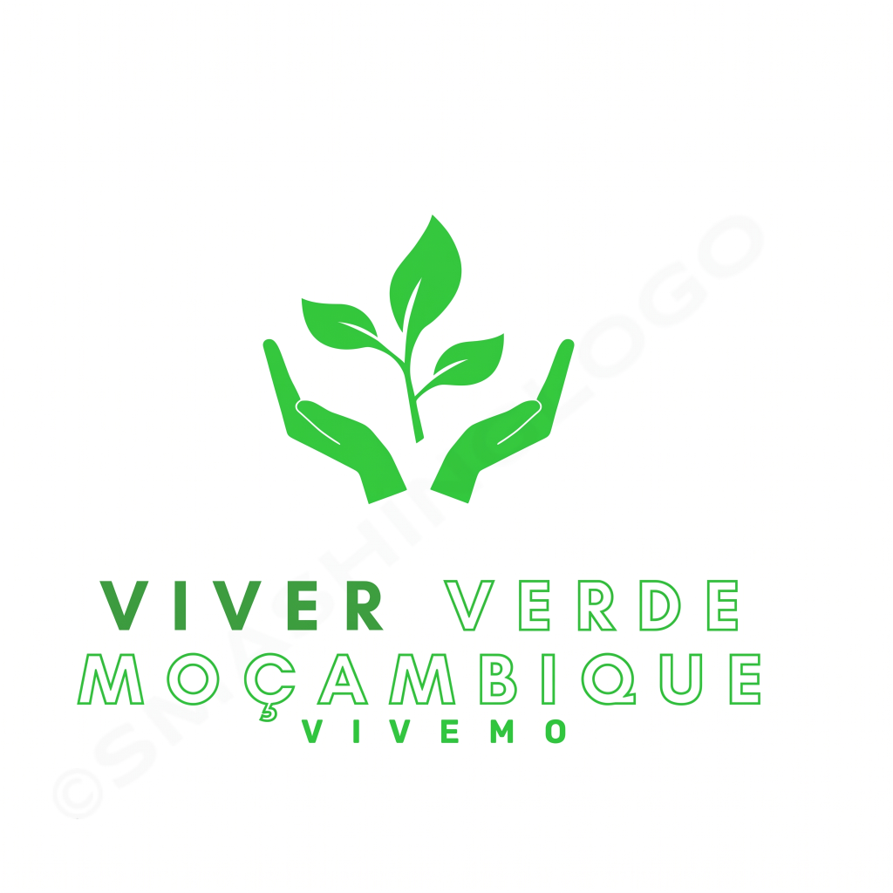

# 🌱 VIVEMOS - Viver Verde Moçambique



**VIVEMOS** (Viver Verde Moçambique) é uma ONG moçambicana dedicada à promoção de soluções tecnológicas agrárias e florestais resilientes às mudanças climáticas.

## 📋 Sobre o Projeto

Desde 2014, trabalhamos com comunidades rurais em 3 províncias do norte de Moçambique (Nampula, Niassa e Cabo Delgado), capacitando mais de 100 famílias com técnicas práticas de agricultura sustentável.

### 🎯 Missão
Promover soluções tecnológicas agrárias e florestais resilientes às mudanças climáticas para as comunidades rurais.

### 🌟 Visão
Ser referência na promoção de soluções tecnológicas agrárias e florestais resilientes às mudanças climáticas.

### 💎 Valores
- Inovação
- Transparência
- Integridade
- Objetividade
- Criatividade
- Compromisso
- Excelência
- Honestidade
- Sustentabilidade

## 📊 Impacto em Números

- **10+** anos de experiência
- **100+** famílias beneficiadas
- **7** projectos activos
- **3** províncias cobertas (Nampula, Niassa, Cabo Delgado)

## 🚀 Iniciativas

1. **Finanças Rurais** - Esquemas de poupança e crédito rotativo
2. **Florestas Comunitárias** - Reflorestação e sistemas agroflorestais
3. **Segurança Alimentar** - Hortas caseiras e produção sustentável
4. **Biopesticidas** - Aumento de produtividade com soluções ecológicas
5. **Capacitação Técnica** - Formação em gestão de negócios e literacia financeira
6. **Apoio a Deslocados** - Segurança alimentar para deslocados internos

## 🌐 Site

Este repositório contém o código-fonte do site institucional da VIVEMOS, desenvolvido com:

- **HTML5** - Estrutura semântica e acessível
- **CSS3** - Design modular e responsivo
- **JavaScript (ES6+)** - Funcionalidades interativas
- **Mobile-First** - Otimizado para todos os dispositivos

### 📁 Estrutura do Projeto

```
vivemos/
├── assets/
│   └── images/          # Imagens do site
├── css/
│   ├── base/            # Variáveis, reset, tipografia
│   ├── components/      # Botões, cards, forms
│   ├── layout/          # Header, footer, navbar
│   ├── sections/        # Seções da página
│   ├── utils/           # Animações, responsivo
│   └── main.css         # Import principal
├── js/
│   ├── modules/         # Módulos JavaScript
│   ├── utils/           # Funções auxiliares
│   └── main.js          # Entry point
└── index.html           # Página principal
```

## 🛠️ Tecnologias

- HTML5 Semântico
- CSS3 com CSS Variables
- JavaScript ES6+ Modules
- Font Awesome Icons
- Google Fonts (Montserrat, Open Sans)

## 📱 Funcionalidades

- ✅ Design Responsivo (Mobile-First)
- ✅ Navbar com menu mobile
- ✅ Galeria interativa com lightbox
- ✅ Mapa interativo de actuação
- ✅ Contador animado de estatísticas
- ✅ Formulário de contacto
- ✅ Newsletter
- ✅ Scroll reveal animations
- ✅ Back to top button
- ✅ Preloader

## 🚀 Como Usar

1. Clone o repositório:
```bash
git clone https://github.com/seu-usuario/vivemos.git
```

2. Abra o arquivo `index.html` no navegador ou use um servidor local:
```bash
# Com Python
python -m http.server 8000

# Com Node.js (http-server)
npx http-server
```

3. Acesse: `http://localhost:8000`

## 📞 Contacto

- **Email:** vivemos@vivemos.org.mz
- **WhatsApp:** (+258) 857 051 895
- **Telefone:** (+258) 843 119 116
- **Localização:** Bairro Urbano Central, Nampula, Moçambique

## 🤝 Colaboradores

Trabalhamos em parceria com:
- INAM
- MITADER
- FAO
- IFAD
- UEM
- GIZ

## 📄 Licença

© 2024-2026 VIVEMOS – Viver Verde Moçambique. Todos os direitos reservados.

Organização sem fins lucrativos | Moçambique

---

**Desenvolvido com 💚 para um Moçambique mais verde e sustentável**
